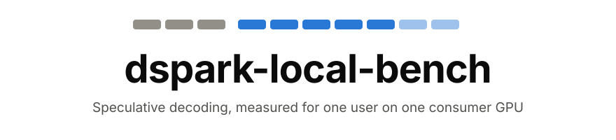
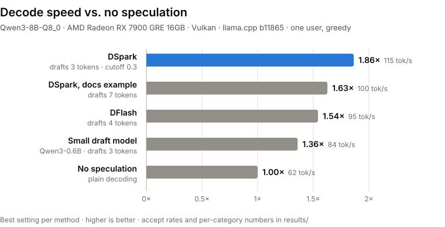

<!-- markdownlint-disable first-line-h1 no-inline-html -->

<div align="center">
  
</div>
<hr>
<div align="center">
  <a href="LICENSE"></a>
  <a href="https://github.com/ggml-org/llama.cpp/releases/tag/b11865"></a>
  <a href="#5-contribute-your-gpu"></a>
  <a href="https://arxiv.org/abs/2607.05147"></a>
  <br>
  <b>Does DSpark speculative decoding make <i>your</i> local LLM faster?</b><br>
  Reproducible single-user benchmarks for llama.cpp on consumer GPUs. Run them on yours and add a row.
</div>

## Table of Contents

1. [Introduction](#1-introduction)
2. [Results](#2-results)
3. [Quick Start](#3-quick-start)
4. [What Gets Measured](#4-what-gets-measured)
5. [Contribute Your GPU](#5-contribute-your-gpu)
6. [Ecosystem Status](#6-ecosystem-status)
7. [License](#7-license)

## 1. Introduction

**Speculative decoding** makes text generation faster without changing the output. A small *draft* model
guesses the next few tokens, and the big model checks all of them in one pass. Every guess it accepts is a
token you didn't have to wait for.

[**DSpark**](https://huggingface.co/papers/2607.05147) is DeepSeek's take on it: the drafter proposes a
whole block of tokens at once, and a trained *confidence head* predicts which of them will survive.
llama.cpp has supported it since July 2026 (`--spec-type draft-dspark`), and Ollama runs it through `DRAFT`
in a Modelfile.

The published speedups come from servers and high-end NVIDIA cards. This project asks the questions a
**single local user** cares about:

- **How much faster is it really** on a consumer GPU, compared with every other speculative method in llama.cpp?
- **Which settings work best:** how many tokens to draft, and whether the confidence cutoff helps or hurts?
- **What does it cost:** how much slower is prompt processing, which you feel as the wait before the first token?

## 2. Results

<p align="center">
  
</p>

<!-- RESULTS:START -->
**AMD Radeon RX 7900 GRE 16 GB · Vulkan · Qwen3-8B Q8_0 · 32 prompts per setting**

- **DSpark is the fastest method: 1.86×**, 115 instead of 62 tokens/s. DFlash reaches 1.54× and a classic
  small draft model 1.36×. n-gram lookup does almost nothing on these prompts (1.02× in the quick screen).
- **Draft 3 tokens, not 7.** The drafters are trained on 7-token blocks and llama.cpp's docs use
  `--spec-draft-n-max 7`, but on this GPU that gives 1.63×. Three tokens is **14% faster**.
- **The confidence cutoff helps only a little.** `--spec-draft-p-min 0.3` adds about 3% (1.81× → 1.86×), in
  both the screen and the full run. Cutoffs of 0.5 and above make it slower, and 0.9 drops it to 1.28×.
- **Keep the drafter at Q8_0.** The BF16 drafter was *slower* (1.55× vs 1.72× at 4 tokens in the screen)
  and no more accurate.
- **Prompt processing barely suffers:** about 8% slower with the drafter loaded.
- **The gain depends on the task:** coding 2.3×, math 1.9×, writing 1.8×, Q&A 1.5×.

The fastest command on this machine:

```bash
llama-server -m Qwen3-8B-Q8_0.gguf -md dspark-Qwen3-8B-Q8_0.gguf --spec-type draft-dspark \
    --spec-draft-n-max 3 --spec-draft-p-min 0.3 -ngl all -ngld all -fa on --device Vulkan0
```

> [!NOTE]
> One GPU, one model and greedy decoding so far, with 8 prompts per category. Treat differences under
> about 3% as noise. Other GPUs may prefer other settings, which is exactly what [contributed results](#5-contribute-your-gpu) will show.
<!-- RESULTS:END -->

Full tables: [all measured settings](results/rx7900gre-win11/qwen3-8b__vulkan.md) and the
[quick screen of 21 settings](results/rx7900gre-win11/qwen3-8b-screen__vulkan.md), with per-category speedups
and acceptance rates.

## 3. Quick Start

**Windows** (PowerShell 7, Python 3.10+, git, about 15 GB of disk):

```powershell
git clone https://github.com/juraj-jumic/dspark-local-bench; cd dspark-local-bench
.\scripts\setup_windows.ps1 -Backend vulkan        # or rocm / cuda: downloads prebuilt llama.cpp, no compiler needed
.venv\Scripts\Activate.ps1
python scripts\fetch_models.py configs\qwen3-8b.json
```

Then a two-minute smoke test, and the real run:

```powershell
python scripts\run_matrix.py --config configs\qwen3-8b.json --backend vulkan --machine my-gpu `
    --server-args "--device Vulkan0" --only baseline,dspark-n7-p0 --limit 1
python scripts\run_matrix.py --config configs\qwen3-8b.json --backend vulkan --machine my-gpu --server-args "--device Vulkan0"
python scripts\summarize.py --write
```

> [!TIP]
> Run `bin\vulkan\llama-server.exe --list-devices` first. If an integrated GPU shows up next to your graphics
> card, keep `--device Vulkan0` (or whichever is the real card), or llama.cpp may split the model across both.

<details>
<summary><b>Linux / macOS</b></summary>

Build llama.cpp at the pinned tag with your backend ([build docs](https://github.com/ggml-org/llama.cpp/blob/master/docs/build.md)):

```bash
git clone https://github.com/juraj-jumic/dspark-local-bench && cd dspark-local-bench
git clone --depth 1 --branch b11865 https://github.com/ggml-org/llama.cpp
cmake -S llama.cpp -B llama.cpp/build -DGGML_CUDA=ON   # or -DGGML_VULKAN=ON / -DGGML_HIP=ON; Metal is the default on macOS
cmake --build llama.cpp/build --config Release -j
python -m venv .venv && . .venv/bin/activate
pip install -r llama.cpp/tools/server/bench/speed-bench/requirements.txt huggingface_hub
python scripts/fetch_models.py configs/qwen3-8b.json
python scripts/run_matrix.py --config configs/qwen3-8b.json --backend cuda --machine my-gpu \
    --server llama.cpp/build/bin/llama-server
python scripts/summarize.py --write
```

</details>

<details>
<summary><b>Short on time?</b> Screen first, then measure the winners</summary>

The full matrix generates about 13,000 tokens for each of its 33 settings, so it takes about 2 hours on a
60 tok/s GPU. A quick screen with 2 prompts per category and 256-token answers is enough to rule out the
clear losers in about 10 minutes:

```powershell
python scripts\run_matrix.py --config configs\qwen3-8b.json --backend vulkan --machine my-gpu `
    --server-args "--device Vulkan0" --name qwen3-8b-screen --limit 2 --osl 256 `
    --only "baseline,ngram-mod,draft-simple-*,dflash-*,dspark-n*-p0,dspark-bf16-*"
```

Then run the best few at full size with `--only baseline,<run ids>` (no `--name`, `--limit` or `--osl`).

</details>

## 4. What Gets Measured

All methods run on the same model (Qwen3-8B, Q8_0), the same prompts and the same GPU, one request at a time:

| Method | What drafts the tokens | Run ids |
|---|---|---|
| No speculation | nothing (the reference) | `baseline` |
| n-gram | repeats patterns already in the text | `ngram-mod` |
| Small draft model | Qwen3-0.6B | `draft-simple-n3`, `-n5` |
| DFlash | a block-diffusion drafter | `dflash-n4`, `-n7` |
| **DSpark** | DFlash plus a Markov head and a confidence head | `dspark-n{2,3,4,5,7}-p{0,0.3,0.5,0.7,0.9}` |

In the DSpark ids, `n` is how many tokens are drafted per step and `p` is the confidence cutoff (`0` = off).
The prompts come from [SPEED-Bench](https://huggingface.co/datasets/nvidia/SPEED-Bench), llama.cpp's own
speculative-decoding benchmark: coding, math, writing and Q&A, greedy decoding, with Qwen3's thinking mode
off (the drafters were trained without it).

Every setting is one JSON entry in [configs/](configs/), so adding a model or a sweep needs no code.

## 5. Contribute Your GPU

The goal is a table that answers *"does DSpark help on my GPU?"* for as many cards as possible.

1. Run a config (see [Quick Start](#3-quick-start)) with a short `--machine` label such as `rtx3060-win11`.
2. Commit `results/<machine>/` and open a pull request. Mention anything unusual: power limits, a laptop, other load on the GPU.

> [!IMPORTANT]
> Only commit `results/`. The raw per-request data and server logs in `runs/` stay local; they're gitignored.

NVIDIA and Apple Silicon results are especially welcome. The first results are from AMD.

## 6. Ecosystem Status

- **llama.cpp:** DSpark merged in [#25173](https://github.com/ggml-org/llama.cpp/pull/25173). The confidence
  head is exposed only as a fixed cutoff (`--spec-draft-p-min`). Adaptive draft length exists only as open PRs for MTP.
- **Ollama:** runs DSpark drafters through `DRAFT` in a Modelfile ([ollama#17016](https://github.com/ollama/ollama/issues/17016)).
- **Drafters:** DeepSeek publishes them for Qwen3-4B/8B/14B and Gemma-4-12B, and the community has made about 100 more.

Details and sources: [docs/status-2026-10.md](docs/status-2026-10.md).

## 7. License

The code is [MIT](LICENSE). Models keep their own licenses (Qwen3: Apache-2.0; for the DSpark drafters, see
their model cards). SPEED-Bench prompts are covered by NVIDIA's evaluation dataset license: this repo never
redistributes them and publishes only aggregate timings.

This is an independent project, not affiliated with DeepSeek, ggml-org or NVIDIA. Questions and results go to
[issues](https://github.com/juraj-jumic/dspark-local-bench/issues).
